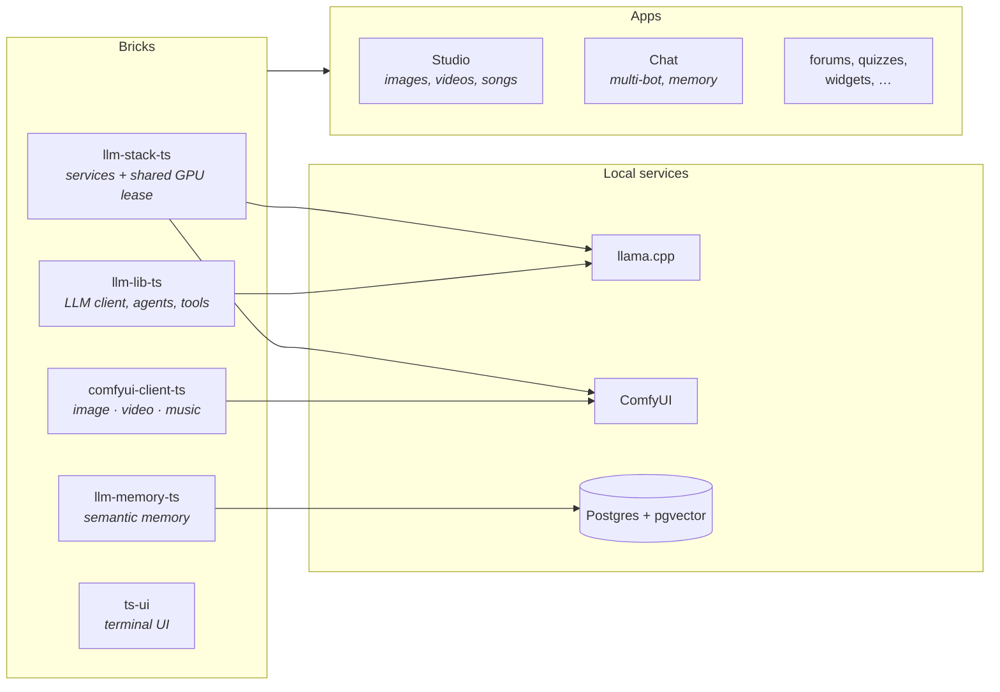

# tivins

**A fully local AI stack on a single 16 GB GPU** — LLM, memory, images, video, music, voice —
built as small reusable bricks in TypeScript on [Bun](https://bun.sh). 
Software architect & developer · TypeScript, PHP, C++, Rust, Python ·
[YouTube][yt] · [Stack Overflow][so] (750+ answers)

## Bricks

| Brick | What it does |
| :--- | :--- |
| [llm-lib-ts][lib] | OpenAI-compatible client (llama.cpp, OpenRouter): chat, streaming, JSON Schema output, `Agent` + `ToolRegistry`, embeddings, rerank |
| [llm-stack-ts][stack] | Starts and stops local services (llama.cpp, ComfyUI, embeddings, STT…) from one `stack.toml`; GPU lease shared between processes |
| [llm-memory-ts][memory] | Long-term semantic memory: Postgres + pgvector, recall (ANN then rerank), deduplication |
| [comfyui-client-ts][comfy] | ComfyUI client: Qwen Image, Krea 2, FLUX 3 Klein, MiniMax H3 (image & video), Wan 2.2, MiniMax Music 3, upscale, interpolation |
| [ts-ui][tsui] | Terminal primitives for Bun CLIs: spinner, steps, colors, timing |

## See it run

Everything below is generated on one home PC, no cloud.

*How my programs learned to share one GPU · A photo becomes a song · A grandmother who doesn't exist comes to life* (in French)

<b>Earlier work</b>

### NLVM

* [nlvm-specs](https://github.com/nlvm-lang/nlvm-specs) — language specifications *(Markdown)*
* [nlvm](https://github.com/nlvm-lang/nlvm) — implementation *(Rust)*
* [vvm](https://github.com/tivins/vvm) — first version, archived *(C++)*

### PHP & tools

* [PHP Solid](https://github.com/tivins/php-solid) — detects LSP and ISP violations in PHP code
* [Inferred Dependency Injection](https://github.com/tivins/poc-di-inferred) — automatic DI by reflection (PoC)
* [API Interface and DTO](https://github.com/tivins/poc-api-interface) — request/response DTOs, typed handler and OpenAPI from one definition (PoC)
* [taskman](https://github.com/tivins/taskman) — project management for AI pipelines (MCP, CLI, web, SQLite)
* [Deven](https://github.com/tivins/deven) — dockerized PHP environment with GPU support
* [comprendre](https://github.com/tivins/comprendre) — documentation in French (patterns, concepts, frameworks, tests)

[yt]: https://www.youtube.com/@tivinsStuff
[so]: https://stackoverflow.com/users/9193372/syscall
[lib]: https://github.com/tivins/llm-lib-ts
[stack]: https://github.com/tivins/llm-stack-ts
[memory]: https://github.com/tivins/llm-memory-ts
[comfy]: https://github.com/tivins/comfyui-client-ts
[tsui]: https://github.com/tivins/ts-ui
